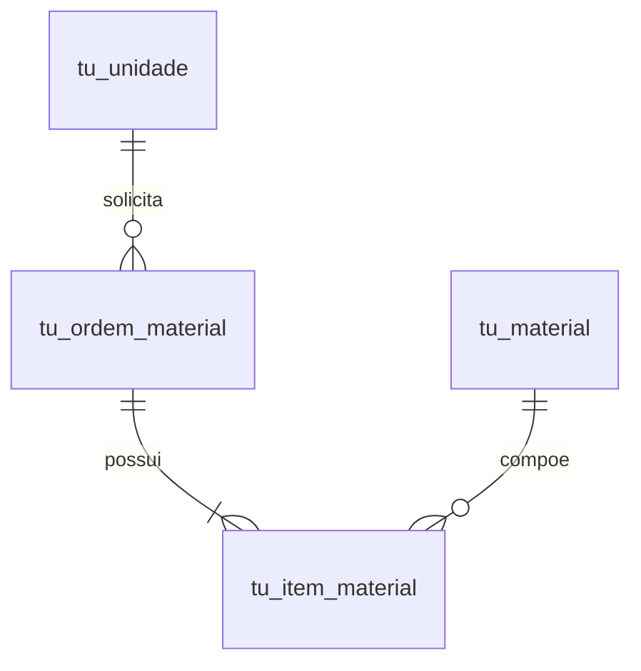

# Banco de dados conferido

Metadados atuais do Supabase, sem copiar registros de pessoas.

| Tabela | Chave primária | Relações documentadas |
|---|---|---|
| cidade | id_cidade |  |
| faixa_exclusiva | id_faixa | id_trecho → trecho.id_trecho |
| linha_onibus | id_linha | id_cidade → cidade.id_cidade |
| linha_trecho | id_linha + id_trecho | id_linha → linha_onibus.id_linha; id_trecho → trecho.id_trecho |
| registro_atraso | id_atraso | id_linha → linha_onibus.id_linha; id_trecho → trecho.id_trecho |
| trecho | id_trecho | id_cidade_origem → cidade.id_cidade; id_cidade_destino → cidade.id_cidade |
| tu_acesso | usuario_id + papel |  |
| tu_alerta_operacional | id |  |
| tu_avaliacao | id | horario_id → tu_horario.id |
| tu_carteira | usuario_id |  |
| tu_chamado | id |  |
| tu_email_acesso | id | pedido_id → tu_pedido_acesso.id |
| tu_favorito | usuario_id + linha_id |  |
| tu_horario | id | trajeto_id → tu_trajeto.id |
| tu_item_material | ordem_id + material_id | ordem_id → tu_ordem_material.id; material_id → tu_material.id |
| tu_manifestacao | id | viagem_id → tu_viagem_operacional.id; motorista_id → tu_motorista.usuario_id |
| tu_manifestacao_evento | id | manifestacao_id → tu_manifestacao.id |
| tu_material | id |  |
| tu_motorista | usuario_id |  |
| tu_ordem_material | id | unidade_id → tu_unidade.id |
| tu_pedido_acesso | id |  |
| tu_perfil | usuario_id |  |
| tu_posicao_atual | viagem_id | viagem_id → tu_viagem_operacional.id |
| tu_recarga | id | usuario_id → tu_carteira.usuario_id |
| tu_suporte_evento | id | chamado_id → tu_chamado.id |
| tu_trajeto | id |  |
| tu_unidade | id |  |
| tu_viagem_operacional | id | motorista_id → tu_motorista.usuario_id |

A chave de tu_item_material é (ordem_id, material_id). O par não pode se repetir; cada coluna também é FK. Os valores monetários usam NUMERIC e os bloqueios de linha estão nas funções de finalização.

A Data API documentou 28 tabelas de public. A tabela de contas do esquema auth é gerenciada pelo Supabase e não é exposta neste relatório. O relatório de metadados não substitui uma auditoria integral de políticas, índices, triggers ou todos os objetos internos.
